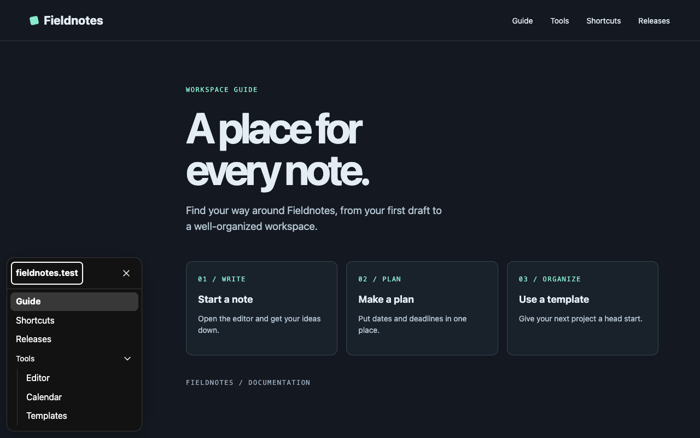

# Sidebar Nav

**A simpler way to navigate websites in Chrome.**

Sidebar Nav adds an optional, expandable navigation sidebar to websites you choose. It is especially useful when a website's navigation is crowded, nested, or difficult to reach in a narrow browser window.

Sidebar Nav was originally created to improve navigation on [Higgsfield.ai](https://higgsfield.ai), where deeply nested features and a crowded horizontal menu can make navigation difficult in smaller browser windows. It has since evolved into a general-purpose navigation enhancement for other websites.

The original website navigation stays in place. Open Sidebar Nav from a small tab on the left edge, browse the saved feature links, and close it when you are done. **Scanning is manual**, and saved navigation is available again when you restart Chrome.

**Free to use · Chrome extension · Manifest V3 · Version 0.5.0**

*Screenshot from the extension's release materials, showing a sample website.*

## What it does

- **Left-edge sidebar:** Open or close an expandable, text-based navigation menu without replacing the site's original navigation.
- **Useful in smaller windows:** Keep links accessible when the site's normal navigation is crowded or horizontally scrollable.
- **Manual discovery:** Click **Scan Navigation** to find additional feature links in the current page's supported menus. Links are grouped by section where their hierarchy can be identified.
- **Remembered navigation:** Save discovered links and your preferences locally for each website. Returning to a site or restarting Chrome does **not** trigger a scan.
- **Site-native appearance:** Follow the site's existing visual styling and theme where possible, including the colour of the left-edge tab.
- **Per-site control:** Grant access, turn the enhanced navigation on or off, clear saved links, or remove access for individual websites.

Higgsfield has a built-in feature-navigation adapter. Other websites use the general navigation discovery logic, so results vary with how their menus are implemented. Sidebar Nav is a **navigation aid**, not a site crawler, bookmark manager, or project browser.

## Install in Chrome

Sidebar Nav is not yet linked to a public Chrome Web Store listing. To install the current release manually:

1. Download [Sidebar Nav 0.5.0](outputs/sidebar-nav-0.5.0.zip).
2. Extract the ZIP to a permanent folder. The extracted release should contain `manifest.json` at its top level.
3. Open `chrome://extensions` in Google Chrome.
4. Turn on **Developer mode**.
5. Click **Load unpacked** and select the extracted folder containing `manifest.json`.
6. Pin **Sidebar Nav** from Chrome's Extensions menu if you want quick access.

**Updating an unpacked installation:** Extract the new release over the **same folder**, then click **Reload** on its card in `chrome://extensions` and refresh open website tabs. Keeping the existing extension installation preserves its local settings and saved navigation. Installing a future Web Store version will generally be a separate extension installation with its own saved data.

Chrome 111 or newer is required by the extension manifest.

## How to use it

1. **Enable a website.** Visit the website, click the Sidebar Nav toolbar icon, choose **Allow Site Access**, and approve Chrome's permission prompt. Reopen the popup if Chrome closes it during permission approval.
2. **Open the sidebar.** Keep **Enhanced Navigation** turned on. Click the small tab on the left edge of the website to open the navigation menu.
3. **Move the tab.** Drag the tab vertically to a comfortable position, or focus it and use the up/down arrow keys. Its position is remembered.
4. **Navigate.** Click a feature link to visit it. Expand sections to reveal saved nested links. Use Enter or Space on supported controls for keyboard interaction.
5. **Discover more features when you choose.** Click **Scan Navigation** in the extension popup. The extension examines supported navigation menus in the **current tab**, saves newly discovered feature links and shows **“X links found and added”**. It also updates **Last Scanned**.

**ON means show the sidebar, not scan the site.** Opening a page, logging in, switching routes, refreshing, and restarting Chrome do not launch a deep scan. If new member-only feature navigation becomes visible after you sign in, run **Scan Navigation** again to discover it.

### Popup controls

| Control | What it does |
| --- | --- |
| **Allow Site Access** | Requests permission to show the sidebar and inspect navigation on the current website. |
| **Remove Site Access** | Stops Sidebar Nav running on that website, while retaining its saved navigation and preferences. |
| **Enhanced Navigation** | Turns the left-edge sidebar on or off for that website. |
| **Scan Navigation** | Manually discovers and saves additional feature links on the current page. |
| **Clear Saved Navigation** | After confirmation, removes scanned links and resets **Last Scanned** for the website. Built-in Higgsfield links remain available. |
| **Last Scanned** | Shows when the last manual scan completed, or **Never**. |

## Privacy and permissions

Sidebar Nav is designed to work **locally**, with no account registration, analytics, advertising, cloud sync, or remote scanning.

- **Website access is opt-in.** The extension starts without website permissions. Chrome asks for access when you select **Allow Site Access** for a particular site.
- **Navigation data stays on your device.** Settings, the tab position, saved feature labels and URLs, and scan timestamps are stored in `chrome.storage.local`.
- **Scans are user-triggered.** The scanner reads navigation links and menu structure from the current page. On sites where you're signed in, it may discover feature links shown to your account, but it is not intended to collect personal projects, files, chats, or other content.
- **No developer-side collection.** The extension does not transmit this navigation data to the developer or a third-party service.
- **You remain in control.** You can clear scanned navigation, remove a site's access, or uninstall the extension.

**Privacy policy:** [Read the privacy policy source document](outputs/chrome-web-store/privacy-policy.md). A separate public HTTPS policy page is planned for Cloudflare hosting and will be linked here once published.

For more detail, see the [Chrome Web Store privacy disclosures](outputs/chrome-web-store/privacy-disclosures.md).

## Limitations and troubleshooting

- **No sidebar on a website?** Open the extension popup and verify **Allow Site Access** has been granted and **Enhanced Navigation** is on. Reload the website if necessary.
- **Few or no links discovered?** Some websites use menus that must be opened before their links appear, or controls without standard link destinations. Try exposing the menu and clicking **Scan Navigation** again.
- **New links missing after signing in?** Run a manual scan after the member-only navigation is visible. Previously cached links are not refreshed automatically.
- **Links change or stop working?** The website may have changed its URLs or menus. Scan again, or clear saved navigation and scan afresh.
- **Can't access the sidebar on a Chrome page?** Chrome internal pages and the Chrome Web Store do not allow this kind of extension injection.
- **Moving between install types?** A manually installed unpacked extension and a later Web Store installation can have different extension IDs, so their saved data may not transfer.

The scanner cannot guarantee every navigation entry will be discovered on every website. Site-specific interaction patterns may require additional compatibility work.

## Development and releases

The [extension source](extension/) contains the Manifest V3 application, popup, content scripts, navigation discovery logic, local storage handling and Higgsfield adapter. Code changes are managed separately from the public-facing documentation.

- [Detailed installation and technical usage](extension/README.md)
- [Sidebar Nav 0.5.0 release ZIP](outputs/sidebar-nav-0.5.0.zip)
- [Chrome Web Store listing draft](outputs/chrome-web-store/listing.md)
- [Submission checklist](outputs/chrome-web-store/submission-checklist.md)
- [Store graphics and screenshots](outputs/chrome-web-store/assets)

### Earlier development builds

- [0.4.2](outputs/sidebar-nav.zip)
- [Phase 3](outputs/custom-nav-phase-3.zip)
- [Phase 2](outputs/custom-nav-phase-2.zip)

These are archived development builds; use 0.5.0 for a fresh installation.

## Distribution and licensing

Sidebar Nav is intended to be distributed **free of charge**. A public Chrome Web Store listing is planned but is not yet available.

**Source-code licence:** No open-source licence has been selected or added yet. Free distribution of the extension does not automatically grant permission to modify or redistribute its source code.
